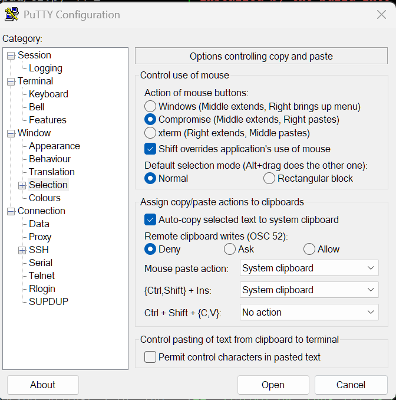
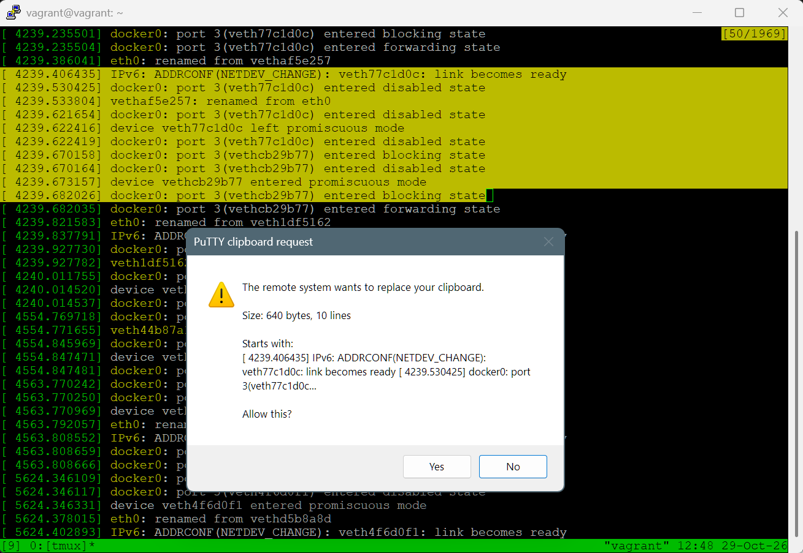

# 0001: OSC 52 clipboard write

Lets a remote program (tmux, vim, ...) copy text to the local
clipboard with the `OSC 52` escape sequence, optionally after the user
confirms.

Putty marks this wishlist item as `priority: never: We don't ever intend to fix this.`.
https://www.chiark.greenend.org.uk/~sgtatham/putty/wishlist/osc52.html

On the one side this option provides convenient copy-paste for remote programs and updating Windows clipboard automatically. See example implementations below.

On the other side, it is a advanced feature that poses security risk if a malicious host writes arbitrary text to the clipboard.

This patch implements a three-state setting (Deny / Ask / Allow) to control this feature with default fail-safe behaviour (Deny).

The Ask mode prompts user before writing to the clipboard.

**Example use case**: Putty with tmux running on a remote host.

## Setting

Window -> Selection -> "Remote clipboard writes (OSC 52)", or
`OSC52Write` in a saved session:

| Mode  | Value | Behaviour                                       |
| ----- | ----- | ----------------------------------------------- |
| Deny  | 0     | Ignore OSC 52 (default).                        |
| Ask   | 1     | Show a dialog; write only if the user confirms. |
| Allow | 2     | Write with no prompt.                           |

## Implementation

Our option is a three-state setting (Deny / Ask / Allow):

- One setting stored in saved session.
- Ask is one prompt per request, Yes or No. The answer is never remembered.

Differences from Ghostty:

- Default is Deny (Ghostty: allow), since PuTTY connects to arbitrary servers.
- After a No, further requests are dropped until the next key press or mouse click, so a host cannot loop dialogs.
- No "remember choice" switch (Ghostty's ask dialog has one); change the setting instead.
- No read support at all (Ghostty has a separate `clipboard-read`).

## Ask mode

The Windows dialog (Yes/No, default No) shows:

- size in bytes and number of lines
- the first 120 characters, with newlines flattened and control and
  bidi-override characters shown as `.` so the preview cannot spoof the text

If the user answers No, further requests are ignored without prompting
until the next key press or mouse click in the window (or a configuration
change). This stops a hostile host from spamming dialogs, while the next
copy after you resume work prompts again.

The GTK (Unix) front end has no dialog yet: Ask acts as Deny there.

## What is supported

Write only:

    ESC ] 52 ; <selection> ; <base64 text> (BEL | ESC \ | C1 ST)

- Text goes to the system clipboard on Windows, and to the `CLIPBOARD`
  selection on Unix.

## What is deliberately not possible

- Reading the clipboard. A query (`?` as data) is ignored and never
  answered, so a remote host cannot exfiltrate clipboard contents.
- Choosing a target. The selection parameter must be lowercase
  letters/digits to be accepted, but its value is ignored; everything
  goes to the one clipboard above (`c`, `p`, `s`, empty all behave the same).
- Large or malformed payloads. Silently dropped (no partial write, no
  prompt) if:
  - decoded size is over 100 KiB or the payload is empty
  - Base64 is invalid (bad characters, whitespace, wrong padding)
  - decoded text is not valid UTF-8 or contains NUL
  - there is no `;` separator or the selection parameter is invalid
- A sequence aborted before its terminator (e.g. by a newline) writes
  nothing.

Newlines are converted to the platform selection newline (CRLF on
Windows); `\r\n` in the input becomes one newline.

## Other implementations

Checked with AI against each project's docs or source (Oct 2026).

| Terminal         | Setting                                                                            | Write default      | Read                             | Prompt                         |
| ---------------- | ---------------------------------------------------------------------------------- | ------------------ | -------------------------------- | ------------------------------ |
| Ghostty          | `clipboard-write`, `clipboard-read` = `allow`, `deny`, `ask`                       | allow              | ask                              | yes, per request; can remember |
| kitty            | `clipboard_control`: `write-clipboard`, `write-primary`, `read-clipboard-ask`, ... | allow              | ask                              | reads only                     |
| Alacritty        | `osc52` = `Disabled`, `OnlyCopy`, `OnlyPaste`, `CopyPaste`                         | allow (`OnlyCopy`) | off                              | none                           |
| foot             | `osc52` = `disabled`, `copy-enabled`, `paste-enabled`, `enabled`                   | allow (`enabled`)  | allow                            | none                           |
| iTerm2           | "Applications in terminal may access clipboard" (`AllowClipboardAccess`)           | off                | separate setting, asks each time | warning bar only               |
| Windows Terminal | `compatibility.allowOSC52`                                                         | allow              | not implemented                  | none                           |

Notes:

- Ghostty: `ask` on a write shows a dialog with a "remember choice for this
  terminal session" switch (GTK source); remembering rewrites the policy to
  `allow` or `deny`.
- Alacritty and foot call reading "paste".
- iTerm2: a denied write shows an announcement with a button to open the setting.
- Windows Terminal: writes happen only while the pane is focused.

Most terminals use an on/off switch, or allow writes and gate only reads.
Ghostty is the only one with a per-request prompt for writes, and the
closest model.
